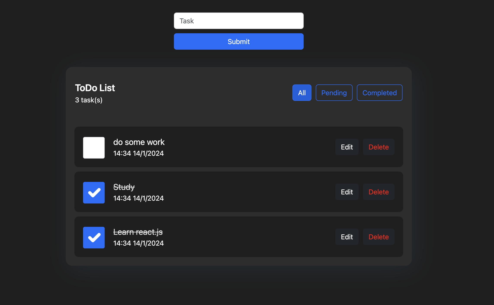

# React To-Do App



**Live demo:** https://react-todo-app-nine-blond.vercel.app/

A to-do list app with full create, read, update, and delete support, built to practice React state management with TypeScript.

**Stack:** React 18 · TypeScript · Vite · Bootstrap 5

---

## Features

- Add tasks (each stamped with the time it was created)
- Edit a task's name in a modal
- Mark tasks complete or incomplete
- Delete tasks
- Filter by **All**, **Pending**, or **Completed**, with a live task count
- Tasks persist across page reloads using a custom `useLocalStorage` hook

## How it's built

- **`useLocalstorage` hook** — wraps `useState` so the task list is read from `localStorage` on first render and written back whenever it changes
- **Typed state** — tasks share one `taskProperties` interface (`id`, `name`, `time`, `completed`), with IDs from `crypto.randomUUID()`
- **Components** — `AddTask`, `DisplayTask` (list, filters, toggle, delete), and `UpdateTask` (edit modal)

## Running locally

```bash
git clone https://github.com/num-err/TODO.git
cd TODO
npm install
npm run dev
```

Open the URL Vite prints (usually `http://localhost:5173`).
